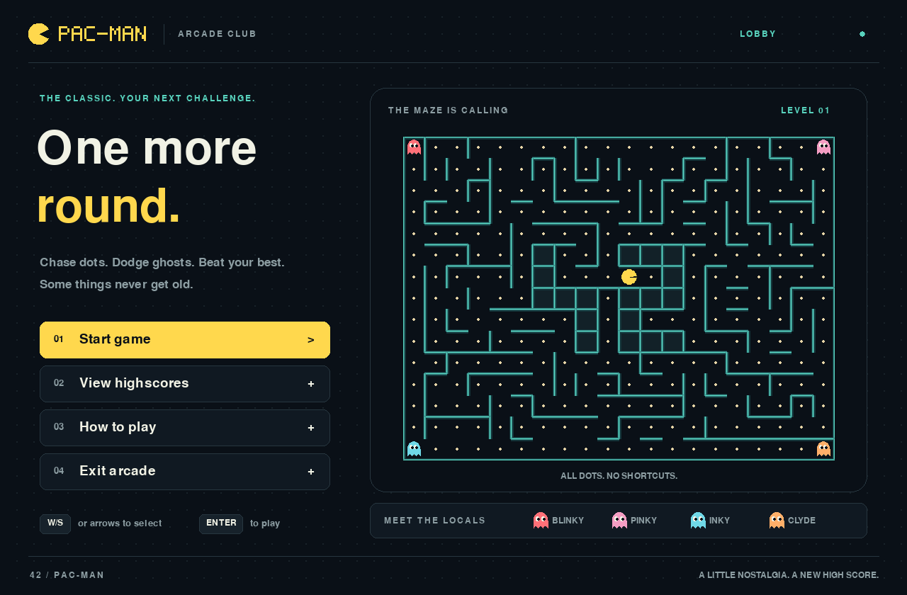

# PAC-MAN / Arcade Club

A desktop Pac-Man game with a warm yellow and teal arcade interface. Built
with Python 3.13 and Pygame. The frontend displays engine snapshots; movement,
collisions, scoring, timers and level progression stay in the engine.



## Play from source

```sh
uv sync
make run
```

To use a specific configuration:

```sh
make run ARG=/absolute/path/to/config.json
# or, from any working directory:
/path/to/pac-man/.venv/bin/python /path/to/pac-man/pac-man.py /path/to/config.json
```

The window can be resized. The interface keeps its proportions with
letterboxing, and mouse positions follow the scaled interface.

| Action | Controls |
| --- | --- |
| Move | Arrow keys or WASD |
| Select a menu item | Up/down, W/S or Tab |
| Confirm | Enter or Space; menu buttons also accept clicks |
| Pause / resume | P or Escape |
| Return from instructions / highscores | Escape |
| Enter a score name | Type; Backspace to edit; Enter to save |
| Skip saving a score | Escape on the result screen |
| Exit | Exit arcade in the menu, Escape in the menu, or close the window |

Eat all dots and power pellets to advance. Power pellets make ghosts edible,
shown with a blue body, frightened face and white flashes. Clear all levels
to win. Running out of lives or time ends the game. The result screen accepts
1-10 ASCII letters, numbers or spaces; names cannot be blank.

## Interface

- Main menu with a real engine maze preview and four keyboard-accessible actions.
- Maze with animated Pac-Man, distinct ghosts, pulsing pellets and cached walls.
- HUD displaying score, lives, level and remaining time from the snapshot.
- Pause overlay; losing window focus also pauses gameplay.
- Separate victory and game-over messages, final score and validated score entry.
- Persistent top-10 table, empty state and illustrated instructions.
- One 60 FPS loop with bounded, fixed simulation steps. Presentation eases
  between observed cells without predicting movement or changing the engine.

Fonts ship with Pygame. The wordmark and sprites are drawn in code; no network
or host fonts are needed at runtime. The original temporary UI remains in
`tester.py` for reference; `pac-man.py` now launches `frontend/app.py`.

## Configuration and saved scores

Without an explicit config argument, the game first checks for `config.json`
in its user data directory, then uses the config bundled with the game.
It never depends on the current working directory.

| Platform | Default data directory |
| --- | --- |
| macOS | `~/Library/Application Support/Pac-Man/` |
| Windows | `%APPDATA%/Pac-Man/` |
| Linux | `$XDG_DATA_HOME/pac-man/` or `~/.local/share/pac-man/` |

`highscore_filename` defaults to `highscores.json`. Relative score filenames
use the data directory by default. With an explicit config argument, relative
score filenames resolve beside that config. Absolute filenames are honored.
`PACMAN_DATA_DIR` overrides the default data directory, useful for a portable
install or isolated testing. Parent directories are created when saving.

Score files are replaced atomically. A failed write keeps the name screen open,
explains the error, and leaves the previous scores intact so the player can retry.

## Standalone build

```sh
make build
make check-build
```

PyInstaller includes the Python runtime, Pygame, its default font, engine,
frontend and default config. Recipients do not need Python or the source code.
Build on the operating system and architecture you intend to distribute:

- macOS: distribute `dist/Pac-Man.app` (the complete app).
- Windows: distribute the complete `dist/Pac-Man/` folder; run `Pac-Man.exe`.
- Linux: distribute the complete `dist/Pac-Man/` folder; run `Pac-Man`.

Do not distribute the executable alone from inside the folder. The macOS build
is locally signed by PyInstaller; public distribution still requires your own
Developer ID signing and notarization. Windows and Linux build recipes are
provided; they need validation on those operating systems.

`make check-build` copies the built app outside the source tree and launches it
from a temporary working directory with both bundled and explicit configs.
It checks the rendered startup, four ghosts and resolved score paths, with
`PYTHONPATH` and `PYTHONHOME` removed. You can also run the executable with
`--smoke-test` for a headless startup check that does not write scores.

Bundle resource lookup follows
[PyInstaller's runtime path guidance](https://pyinstaller.org/en/stable/runtime-information.html).

## Verification

```sh
make test
make lint
```

The standard-library integration suite uses the real engine and SDL's dummy
display. It covers keyboard and mouse navigation, all movement mappings,
pause/focus behavior, restart, bounded updates, result transitions, invalid
names, score persistence and write failures, top-10 ordering, portrait mazes,
resizing and launch from an unrelated directory. `make lint` checks the new
frontend, scripts and tests; mypy checks the frontend against the engine imports.

Project history, ownership and remaining submission checks are in
[`docs/project-management/`](docs/project-management/README.md).

For a file-by-file explanation of the frontend additions, engine integration,
and build tools, see the [frontend implementation guide](docs/frontend-changes.md).
