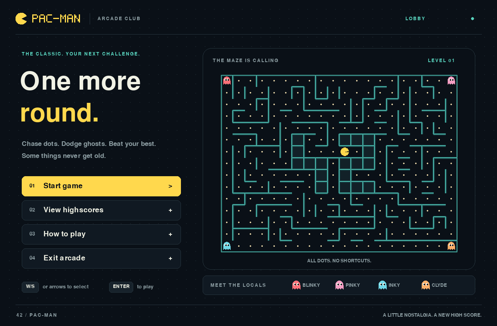

# Frontend additions and implementation guide

This document explains the frontend, integration changes, build tools, tests,
and documentation added for the Pac-Man UI work on 2026-11-10.

The project previously launched the temporary interface in `tester.py`. It now
launches a complete Pygame application with menus, gameplay rendering, pause,
instructions, highscores, and end-of-game name entry. The existing engine still
owns movement, collisions, scoring, ghost behavior, timers, and level progression.

## 1. Files added

| File | Purpose |
| --- | --- |
| [`frontend/__init__.py`](../frontend/__init__.py) | Makes the frontend directory an importable Python package. |
| [`frontend/app.py`](../frontend/app.py) | Owns the window, event loop, input handling, screen navigation, and screen layouts. |
| [`frontend/theme.py`](../frontend/theme.py) | Defines the shared palette, typography, panels, buttons' drawing primitives, wordmark, and sprites. |
| [`frontend/maze.py`](../frontend/maze.py) | Draws maze snapshots, caches wall graphics, and animates observed entity positions. |
| [`frontend/paths.py`](../frontend/paths.py) | Resolves bundled resources, configuration, and writable score locations. |
| [`Pac-Man.spec`](../Pac-Man.spec) | Describes what PyInstaller includes in the standalone distribution. |
| [`scripts/build.py`](../scripts/build.py) | Runs the standalone build using paths anchored to the repository. |
| [`scripts/check_build.py`](../scripts/check_build.py) | Copies a built distribution away from the source and checks that it launches independently. |
| [`tests/test_frontend.py`](../tests/test_frontend.py) | Contains 14 integration tests using the real engine and a headless Pygame display. |
| [`docs/images/main-menu.png`](images/main-menu.png) | Shows the main menu in the README. |
| [`docs/frontend-changes.md`](frontend-changes.md) | This detailed explanation of the additions. |



## 2. Application structure and engine integration

The normal startup flow is:

```text
pac-man.py
  -> choose config and score paths
  -> create GameEngine
  -> create Application
  -> run the event/update/draw loop
```

`Application` coordinates the engine through its public methods:

| Engine call | Frontend use |
| --- | --- |
| `start_new_game()` | Creates the initial menu preview and starts a fresh game when requested. |
| `set_direction(direction)` | Passes arrow-key or WASD input to the engine. |
| `pause_game()` | Toggles the engine between playing and paused. |
| `update(frame_time)` | Advances gameplay during the playing screen. |
| `snapshot()` | Supplies the state used to draw the maze, actors, and HUD. |
| `submit_name(name)` | Validates and saves a completed game's score. |

The frontend also reads `engine.highscores.top(10)` for the score table and
`engine.highscores.last_error` when a submission fails. Gameplay rendering reads
`GameSnapshot`; it does not inspect the engine's player, ghost AI, or rules
objects to decide what should happen in the game.

At startup, the application starts an engine session and takes a snapshot for
the main-menu preview. It does not advance that session while the menu is open.
This also avoids requesting a snapshot before the engine has generated a level.
Selecting Start game starts a fresh session.

## 3. Window and main loop

`frontend/app.py` adds one application loop shared by every screen. Each frame:

1. Uses the Pygame clock to target 60 FPS.
2. Reads and handles pending window, keyboard, mouse, and text-input events.
3. Advances the engine when the active screen is `PLAYING`.
4. Draws the current screen onto the logical canvas.
5. Scales the canvas into the window and presents the result.

Engine updates use fixed steps of `1 / 60` second. The incoming elapsed time is
limited to 0.1 seconds per frame, preventing a long stall from causing a large
simulation jump. Screen changes reset the accumulated simulation time.

The interface is designed on a **1280 × 840 logical canvas**. The initial window
size considers the desktop size, and the player can resize it afterward. The
canvas scales proportionally, with empty margins when the window has a different
aspect ratio. Mouse coordinates are converted back into canvas coordinates so
buttons remain clickable after resizing.

The application also sets a window title and a code-drawn Pac-Man window icon.
Closing the window exits the loop, and `pygame.quit()` runs when the loop ends.

## 4. Screens and navigation

The `Screen` enum defines six application states:

| State | What the player sees |
| --- | --- |
| `MENU` | Main menu and a static engine maze preview with animated presentation. |
| `PLAYING` | Maze, actors, score, time, lives, level, and pause button. |
| `PAUSED` | Dimmed gameplay behind a resume/main-menu overlay. |
| `SCORES` | The top 10 saved scores or an empty-state message. |
| `INSTRUCTIONS` | Controls, objectives, power pellets, losing conditions, and name rules. |
| `RESULT` | A victory or game-over message, final score, and name-entry form. |

`navigate()` changes screens, resets menu selection and simulation accumulation,
and enables text input only on the result screen.

### Main menu

The menu provides Start game, View highscores, How to play, and Exit arcade.
It includes a maze preview generated by the engine, a four-ghost legend, and
visible keyboard hints. Menu selection wraps from the last item to the first
and from the first to the last.

### Gameplay and HUD

The maze occupies the main panel. A sidebar shows:

- The current level.
- The score, with leading zeros for ordinary scores.
- Remaining time formatted as minutes and seconds; it turns red at 30 seconds.
- Life icons and the numerical life count.
- A short objective reminder and a pause button.

These values come from the snapshot. Formatting the timer and drawing life
icons do not change the engine's values. Before Pac-Man starts moving, the maze
panel shows a direction prompt.

### Pause

P or Escape pauses gameplay. Losing window focus also pauses an active game.
The overlay offers Resume game and Back to main menu. P or Escape resumes from
the pause screen.

While paused, the frontend does not call the engine's update method. The maze
animation clock also stops. Starting again from the main menu resets the game.

### Game over and victory

The frontend checks each updated snapshot for `State.GAME_OVER` or
`State.VICTORY`. Both open the result form, with different messages and artwork.
The form shows the engine's final score and lets the player save it under a name.

An accepted name returns the player to the main menu with a brief saved-score
notice. Escape returns without saving. Invalid input or a failed disk write
keeps the player on the form and shows an explanation.

### Highscores and instructions

The highscores screen displays rank, player name, and score for up to 10 entries.
The highest entry receives a yellow highlight. An empty list shows an invitation
to play instead of an empty table. Scores are supplied by the existing score store.

The instructions screen explains movement, buffered turns, pause, collecting
dots and power pellets, edible ghosts, lives, time, victory, and score names.
Both screens provide buttons to return to the menu or start a game.

## 5. Keyboard, mouse, and name input

| Context | Input | Behavior |
| --- | --- | --- |
| Gameplay | Arrow keys or WASD | Sends the matching `Direction` to the engine. |
| Gameplay | P or Escape | Pauses. |
| Paused | P or Escape | Resumes. |
| Menus | Up/W/Left/A | Selects the previous action. |
| Menus | Down/S/Right/D/Tab | Selects the next action. |
| Menus | Enter, keypad Enter, or Space | Activates the selected action. |
| Main menu | Escape | Exits the application. |
| Highscores/instructions | Escape | Returns to the main menu. |
| Result form | Text input | Adds supported characters to the name. |
| Result form | Backspace | Deletes the last character. |
| Result form | Enter or keypad Enter | Submits the name and score. |
| Result form | Escape | Returns without saving. |
| Buttons | Mouse movement and left click | Selects and activates the button. |

Name typing uses Pygame `TEXTINPUT` events. The field accepts English letters,
digits, and spaces, with a maximum of 10 characters. Attempts to add unsupported
characters or exceed the limit display an error without adding that input.
Blank or spaces-only submissions are rejected by the score store.

Text-input mode starts when the result form opens and stops when it closes.
The text-input rectangle follows the scaled window coordinates for SDL's input
method positioning.

## 6. Visual design and drawing

`frontend/theme.py` centralizes the visual style:

- Dark ink background, slightly lighter panels, and subtle borders.
- Warm yellow for Pac-Man, main actions, and score emphasis.
- Teal maze accents and interface labels.
- Distinct red, pink, cyan, and orange ghost colors.
- A dotted background, rounded panels, selected-button outlines, and key hints.
- A custom block-letter Pac-Man wordmark and shared header/footer styling.

The `Painter` class supplies reusable helpers for text, spaced labels, panels,
keycaps, the wordmark, Pac-Man, ghosts, and the background. It uses Pygame's
bundled default font rather than relying on fonts installed on the player's
computer. Sprites and lettering are drawn in code, so no downloaded artwork is
required at runtime.

Pac-Man's mouth animates and faces the direction from the snapshot. Ghosts have
eyes and animated lower edges. Edible ghosts use blue bodies, frightened faces,
and periodic white flashes with contrasting facial features. These flashes are
a visual treatment while the snapshot marks a ghost edible; the frontend does
not infer when the engine's power-pellet effect will expire.

### Maze rendering and animation

`MazeRenderer` fits the grid inside the available panel while preserving square
cells. It draws walls, enclosed cells, dots, pulsing power pellets, ghosts, and
Pac-Man from `GameSnapshot`.

Wall geometry is cached in a separate surface. A change to the wall-grid
identity, grid dimensions, or rendered dimensions rebuilds that surface.
Dots, pellets, and actors are drawn over it each frame.

For ordinary moves between adjacent observed cells, actor positions interpolate
over 0.12 seconds. This makes grid movement look smoother without predicting
future movement. Distant position changes snap into place, and level/life
changes clear the animation history so respawns do not slide across the maze.

## 7. Changes to existing engine files

Three existing engine files received integration or persistence changes:

| File | Change and reason |
| --- | --- |
| [`engine/engine.py`](../engine/engine.py) | `GameEngine` accepts optional `config_path` and `highscore_path` arguments, allowing the launcher to supply locations independent of the working directory. |
| [`engine/parser.py`](../engine/parser.py) | `get_config()` accepts an optional config path. Without one, it retains command-line fallback behavior and uses `config.json` when no argument exists. |
| [`engine/highscores.py`](../engine/highscores.py) | Adds explicit save success/failure, an error message for the UI, parent-directory creation, atomic file replacement, and rollback after failed submissions. |

The save sequence now writes JSON to a temporary file beside the destination,
flushes it, calls `fsync`, and uses `os.replace` to replace the score file. Temporary
files are cleaned up where possible. If saving fails, `submit()` restores the
previous in-memory list and returns `False`; the form retains the player's name
for a retry.

The existing name rules, top-10 sorting, and score format remain in the score
store. Movement, game rules, ghost AI, maze generation, and the shared snapshot
types were not changed by this frontend work. `tester.py` remains available as
the original temporary interface, but is no longer the normal entry point.

## 8. Configuration and score paths

`frontend/paths.py` separates bundled resources from writable player data.
Resource paths are anchored to the module location, which also works inside a
PyInstaller bundle.

Without an explicit config argument, the launcher checks for `config.json` in
the user data directory, then falls back to the bundled config.

| Platform | Default user data directory |
| --- | --- |
| macOS | `~/Library/Application Support/Pac-Man/` |
| Windows | `%APPDATA%/Pac-Man/`, with a home-directory fallback if `APPDATA` is absent. |
| Linux | `$XDG_DATA_HOME/pac-man/`, or `~/.local/share/pac-man/`. |

Score paths follow these rules:

1. An absolute `highscore_filename` is used directly.
2. With an explicit config argument, a relative score filename resolves beside that config.
3. Otherwise, a relative score filename resolves inside the user data directory.

`PACMAN_DATA_DIR` overrides the default data directory. This supports portable
installs and lets tests keep their files separate from real player data.

## 9. Launcher, dependencies, and Makefile

[`pac-man.py`](../pac-man.py) now uses `argparse`, accepts an optional positional
config path, resolves paths, creates the engine/application, and launches the UI.
It also supports `--smoke-test`, which selects SDL dummy drivers, starts a game,
updates and renders a frame, prints basic state/path information, and exits
without writing a score.

[`pyproject.toml`](../pyproject.toml) now has a project description and a separate
`build` dependency group containing `pyinstaller>=6.16,<7`.
[`uv.lock`](../uv.lock) records that group and its resolved dependencies. The
existing runtime and lint dependencies were retained.

The [`Makefile`](../Makefile) exposes these commands:

| Command | Purpose |
| --- | --- |
| `make install` | Synchronizes dependencies with `uv sync`. |
| `make run` | Launches the new frontend with its default config selection. |
| `make run ARG=/path/to/config.json` | Launches with an explicit config; the argument is quoted to support spaces. |
| `make debug` | Launches the entry point through Python's debugger. |
| `make test` | Runs the integration suite with SDL dummy video/audio. |
| `make lint` | Runs flake8 on the frontend, scripts, tests, and launcher; runs mypy on the frontend. |
| `make build` | Runs the PyInstaller build with the build dependency group. |
| `make check-build` | Checks the copied standalone distribution. |
| `make clean` | Removes project bytecode caches, the mypy cache, and build intermediates; skips bytecode inside `.venv`. |

The default `ARG` is empty so the launcher's config-selection rules can apply.
Build artifacts, a local uv cache, and Ruff's cache were added to
[`.gitignore`](../.gitignore). The existing ignored highscore and environment
files remain ignored. `make clean` leaves the `dist` release output in place.

## 10. Standalone packaging

`Pac-Man.spec` includes the application, engine imports, runtime dependencies,
and default config. Pygame's packaging hook includes its required resources,
including the font used by the UI. The spec excludes unused optional packages
such as NumPy, Matplotlib, and Tkinter.

`scripts/build.py` locates the repository from its own file, directs build
intermediates and PyInstaller's cache into `build`, and writes releases to `dist`.
On macOS the spec also creates an application bundle with a bundle identifier,
version metadata, and high-resolution support.

| Platform | Distribution to give the player |
| --- | --- |
| macOS | The complete `dist/Pac-Man.app`. |
| Windows | The complete `dist/Pac-Man/` folder, containing `Pac-Man.exe`. |
| Linux | The complete `dist/Pac-Man/` folder, containing `Pac-Man`. |

The distribution includes Python; recipients do not need a separate Python
installation or the source tree. Folder builds must be distributed with their
support files, not as an executable copied out on its own.

`scripts/check_build.py` copies the distribution to a temporary location,
preserving symlinks, and launches its executable from that directory. It removes
`PYTHONPATH` and `PYTHONHOME`, isolates player data, and checks two launches: one
using bundled configuration and one using an explicit config. It checks for the
expected maze/four ghosts, resolved score paths, and no source-directory path
in the startup output.

## 11. Tests and verification

The integration suite uses the real engine and SDL's dummy display. Its 14 tests
cover:

1. Menu wrapping, keyboard navigation, and screen routes.
2. Every arrow-key and WASD direction mapping.
3. A fully frozen engine snapshot during pause and time advancing after resume.
4. Focus-loss pause and a fresh game after returning to the menu.
5. Victory, invalid names, editing, saving, and reloading the saved entry.
6. Game over and returning without saving.
7. Failed disk replacement, preservation of existing scores, cleanup, and retry.
8. Top-10 sorting, trimming, and persistence.
9. Mouse hit testing after window resizing and letterboxing.
10. Bounding a large elapsed frame time.
11. Rendering every screen with a portrait maze configuration.
12. Exiting the actual event loop through a window-close event.
13. Resolving a relative score path beside an explicit config.
14. Default/user config selection and source launch from another directory.

During the implementation session, all 14 tests, flake8, and frontend mypy
checks passed. Rendered screens were inspected, and the macOS arm64 distribution
passed the copied-build checks with both configuration modes.

Interactive testing on a real display and Windows/Linux builds remain to be
verified. Builds should be produced on their target OS and architecture. The
macOS build has PyInstaller's local signature; Developer ID signing and
notarization for public distribution were not added. The project's existing
MLX-equivalence submission review also remains open.

## 12. Documentation and generated output

The previously empty [`README.md`](../README.md) now explains running the game,
controls, config/data locations, packaging, and verification. The main-menu
screenshot provides a visual preview.

The following project-management documents were updated:

| Document | Added information |
| --- | --- |
| [`progress.md`](project-management/progress.md) | A 2026-11-10 entry describing the frontend implementation and checks. |
| [`decisions.md`](project-management/decisions.md) | Frontend architecture, visual direction, window behavior, paths, score writes, and packaging choices. |
| [`test-plan.md`](project-management/test-plan.md) | Integration coverage, rendered-screen checks, standalone checks, and remaining manual testing. |
| [`blockers.md`](project-management/blockers.md) | How startup snapshots, resizing, silent save failures, and working-directory paths were handled. |
| [`risks.md`](project-management/risks.md) | Remaining display/platform verification, release signing, and the existing submission review. |
| [`timeline.md`](project-management/timeline.md) | Frontend implementation status and remaining interactive checks. |

Generated outputs include `build/` intermediates, `dist/Pac-Man/`, and the macOS
`dist/Pac-Man.app`. They are ignored by Git and can be reproduced with `make build`.
## 13. Where to customize the UI

| Desired change | Starting point |
| --- | --- |
| Colors, font sizes, sprites, or wordmark | `frontend/theme.py`: constants and `Painter`. |
| Main menu, HUD, pause, instructions, score table, or result layout | `frontend/app.py`: the corresponding `draw_*` method. |
| Key bindings or input behavior | `KEY_DIRECTIONS`, `handle_event()`, and `handle_key()` in `frontend/app.py`. |
| Screen transitions or actions | `navigate()` and `activate()` in `frontend/app.py`. |
| Wall appearance, pellet drawing, or visual movement | `MazeRenderer` in `frontend/maze.py`. |
| Default config or writable data locations | `frontend/paths.py`. |
| Included release resources or app metadata | `Pac-Man.spec`. |
| Gameplay rules, speeds, scoring, or ghost decisions | The existing engine modules responsible for those behaviors. |
